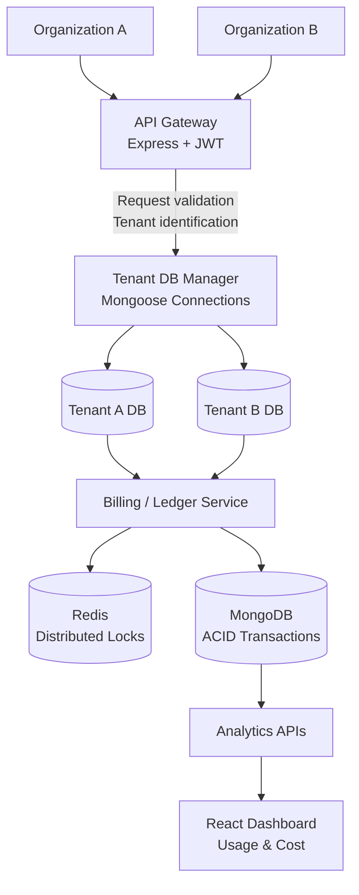
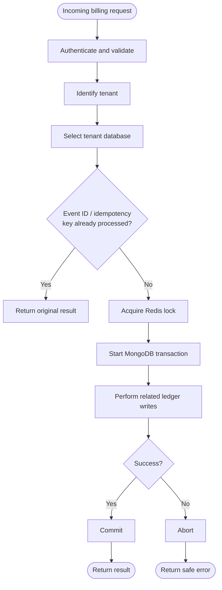

<div align="center">

# 🛡️ LedgerGuard

### Multi-Tenant, Idempotent Billing Engine for Enterprise SaaS

Strict tenant isolation · Exactly-once billing semantics · Cryptographically verified requests · Tenant-scoped analytics

</div>

---

## Table of Contents

- [Overview](#overview)
- [Why LedgerGuard](#why-ledgerguard)
- [Key Features](#key-features)
- [Architecture](#architecture)
- [Billing Transaction Workflow](#billing-transaction-workflow)
- [Security Model](#security-model)
- [Analytics Dashboard](#analytics-dashboard)
- [Technology Stack](#technology-stack)
- [Getting Started](#getting-started)
- [Project Structure](#project-structure)
- [Roadmap](#roadmap)
- [Quality Targets](#quality-targets)
- [Project Status](#project-status)
- [Scope and Design Notes](#scope-and-design-notes)

---

## Overview

**LedgerGuard** is an enterprise SaaS billing-engine project built around two requirements that cannot be compromised: **strict data isolation between organizations** and **reliable financial transaction processing**.

Each authenticated organization is routed to its own isolated MongoDB connection. Billing operations are protected against duplicate requests and partial writes, and each tenant gets a dashboard of its own usage and cost analytics.

---

## Why LedgerGuard

Serving many organizations from one shared application creates four recurring engineering risks:

| Risk | Impact | LedgerGuard's approach |
|---|---|---|
| **Cross-tenant data exposure** | One organization can read another's sensitive billing data | Tenant identity is derived from verified authentication context and routed to an isolated database connection |
| **Duplicate billing operations** | Retries or network failures cause double charges or duplicate ledger entries | Unique event IDs, database constraints, and Redis distributed locks |
| **Inconsistent financial records** | A failure mid-operation leaves the ledger partially updated | MongoDB multi-document ACID transactions with commit or full rollback |
| **Limited usage visibility** | Organizations cannot see consumption or spend over time | Tenant-scoped MongoDB aggregation pipelines feeding a React dashboard |

---

## Key Features

### 1. Secure API Gateway
*Node.js · Express.js · JWT*

- Intercepts and authenticates every incoming request.
- Verifies token signatures, expiry, and required claims.
- Resolves the organization from the authenticated identity and routes the request to the correct tenant context.
- Enforces authentication and authorization through middleware.

### 2. Dynamic Multi-Tenant Database Pool
*MongoDB · Mongoose*

- Manages tenant-specific connections at runtime, including provisioning, reuse, and lifecycle management.
- Guarantees that every tenant-scoped read and write uses the correct tenant connection.

### 3. Idempotent Billing Ledger
*Redis · MongoDB*

- Identifies repeated requests using unique event IDs or idempotency keys.
- Enforces uniqueness at the database level.
- Coordinates concurrent operations with Redis distributed locks.
- Wraps related ledger writes in a MongoDB multi-document transaction, aborting on any failure.

### 4. Usage and Cost Analytics
*MongoDB Aggregation · React · Chart.js*

- Calculates usage and cost metrics per organization across historical time ranges.
- Powers a client dashboard showing resource expenditure and limits.
- Keeps all analytics scoped to the authenticated tenant.

### 5. Cryptographic Request Validation
*RSA-256 asymmetric cryptography*

- Validates payload authenticity on protected API routes using public/private key cryptography.
- Rejects requests that fail signature verification.
- Keeps keys and secrets out of source control.

---

## Architecture



> This diagram shows the intended logical flow. The final connection topology, tenant registry, and deployment arrangement will be confirmed during implementation.

### Example Scenario

When Company A and Company B use LedgerGuard at the same time:

1. Both send requests to the API gateway, which verifies each one and identifies the authenticated organization.
2. The tenant database manager selects each organization's isolated MongoDB connection.
3. Each billing request is checked against its event ID or idempotency key.
4. Redis locking coordinates concurrent processing where required.
5. MongoDB performs the related ledger writes inside a transaction. It commits on success and aborts on failure, so no partial writes remain.
6. Each organization's dashboard retrieves only its own analytics.

A repeated request for the same logical billing event never creates a second billing operation.

---

## Billing Transaction Workflow



**Defense in depth.** A Redis lock alone does not guarantee exactly-once processing. The database uniqueness constraint and the transaction are the authoritative safeguards; the lock reduces contention between concurrent requests.

**Deployment requirement.** MongoDB multi-document transactions require a transaction-capable deployment, such as a replica set or a supported sharded cluster.

---

## Security Model

### Tenant Isolation
- Derive tenant identity from the verified authentication context only.
- Never trust a tenant ID or database name supplied by the client.
- Verify that every tenant-scoped operation uses the correct tenant connection.
- Test explicitly that one tenant cannot access another tenant's records.

### Authentication and Authorization
- Verify JWT signatures, expiry, issuer, and audience.
- Validate required claims and permissions.
- Protect private endpoints with middleware.
- Return safe, non-revealing errors for invalid or unauthorized requests.

### Billing Integrity
- Enforce unique event identifiers with database constraints.
- Coordinate concurrent operations with Redis locks.
- Use MongoDB transactions for all related writes.
- Test retry, timeout, duplicate, and rollback scenarios.

### Cryptographic Validation
- Verify signatures with the public key using the agreed RSA signature format.
- Keep private keys and secrets secure and out of version control.
- Define payload canonicalization and replay-protection requirements as part of the API security contract.

---

## Analytics Dashboard

The React dashboard lets each organization understand its own resource usage and spend. For every analytics request, the backend:

1. Identifies the authenticated tenant.
2. Filters records to that tenant.
3. Applies the requested historical time range.
4. Aggregates usage and cost metrics in MongoDB.
5. Returns structured JSON for the dashboard visualizations.

Chart.js is used to visualize active resource expenditure and limits.

---

## Technology Stack

| Layer | Technologies | Purpose |
|---|---|---|
| Frontend | React, TypeScript | Enterprise client dashboard |
| Charts | Chart.js | Usage and expenditure visualizations |
| Backend | Node.js, Express.js | REST API and application services |
| Database | MongoDB, Mongoose | Tenant data, billing events, ledger records |
| Coordination | Redis | Distributed locks |
| Authentication | JWT | Request authentication and tenant identity |
| Cryptography | RSA-256 | Asymmetric request/payload validation |
| Testing | Jest, Supertest | Unit and API integration tests |

### Engineering Practices
- Non-blocking `async`/`await` throughout.
- JSON-based REST contracts between frontend and backend.
- Modular separation of routes, controllers, services, middleware, and models.
- Configuration and secrets managed through environment variables.

---

## Getting Started

> Exact scripts and deployment configuration will be documented as the implementation is finalized.

### Prerequisites

- Node.js and npm
- MongoDB with transaction support (replica set)
- Redis
- Git
- A modern web browser

### Installation

```bash
git clone https://github.com/bhavik-gitt/LedgerGuard.git
cd LedgerGuard
```

### Configuration

Create a local `.env` file based on `.env.example`. The names below are illustrative; confirm them against the implementation.

```dotenv
NODE_ENV=development
PORT=5000

MONGODB_URI=
REDIS_URL=

JWT_PUBLIC_KEY=
JWT_ISSUER=
JWT_AUDIENCE=

RSA_PUBLIC_KEY=
```

> ⚠️ Never commit real credentials, tokens, private keys, or populated `.env` files.

### Run

Install dependencies and use the scripts defined in the frontend and backend `package.json` files. Commands will be added once the repository setup is finalized.

---

## Project Structure

An illustrative layout, to be adapted to the repository as it evolves:

```text
LedgerGuard/
├── README.md
├── frontend/
│   ├── src/
│   └── package.json
├── backend/
│   ├── src/
│   │   ├── config/
│   │   ├── controllers/
│   │   ├── middleware/
│   │   ├── models/
│   │   ├── routes/
│   │   ├── services/
│   │   └── server.js
│   ├── tests/
│   └── package.json
├── docs/
│   ├── architecture/
│   └── api/
└── .gitignore
```

---

## Roadmap

A four-week implementation plan with two formal reviews.

| Timeline | Backend | Frontend |
|---|---|---|
| **Week 1** | Express API gateway, JWT decoding, runtime Mongoose connection switching for isolated tenant clusters | Enterprise login and multi-tenant dashboard layout |
| **Week 2** | Redis distributed locks, unique event IDs, MongoDB multi-document transactions for the ledger | Billing ledger views and transaction success/failure state management |
| 🔍 **Mid-project review** | Isolation audit; database switching demonstrated under load | UI handling of transaction rollback states demonstrated |
| **Week 3** | MongoDB aggregation queries for usage and cost metrics over historical ranges | Chart.js visualizations for resource expenditure and limits |
| **Week 4** | RSA-256 validation, end-to-end trace logging, secure deployment | Loading states, chart rendering, end-to-end workflow refinement |
| 🏁 **Final review** | Tenant isolation, payload security, and transaction atomicity demonstrated | Accurate multi-tenant usage metering in the dashboard |

---

## Quality Targets

These are goals to be validated through testing, not results already achieved.

| Area | Target |
|---|---|
| Database performance | Evaluate indexed query performance against the sub-5 ms target |
| Tenant isolation | Demonstrate through code review and cross-tenant access tests |
| Transaction integrity | Demonstrate atomic commit and rollback behavior |
| Request security | Demonstrate RSA-256 validation on protected routes |
| Code quality | Clean repository, modular code, comprehensive documentation |
| Delivery | Mid-project review in Week 2; final review in Week 4 |

Performance reports should include the test environment, dataset size, workload, methodology, and measured results.

---

## Project Status

Update each status only after implementation **and** verification are complete.

| Component | Status |
|---|---|
| API Gateway and JWT authentication | 🗓️ Planned |
| Dynamic tenant database management | 🗓️ Planned |
| Tenant isolation tests | 🗓️ Planned |
| Idempotent billing ledger | 🗓️ Planned |
| Redis distributed locks | 🗓️ Planned |
| MongoDB transactions and rollback | 🗓️ Planned |
| Usage and cost analytics APIs | 🗓️ Planned |
| React analytics dashboard | 🗓️ Planned |
| RSA-256 request validation | 🗓️ Planned |
| End-to-end testing and deployment | 🗓️ Planned |

---

## Scope and Design Notes

1. **"Zero-Knowledge" terminology.** The term appears in the project title in the supplied specification, but the specification does not define a zero-knowledge proof protocol. This README does not claim that one is implemented.
2. **RSA-256 details.** The signature scheme, padding, key format, and payload canonicalization must be defined in the implementation's security contract.
3. **Tenant architecture.** The specification calls for runtime provisioning and switching of isolated MongoDB clusters. The tenant registry, connection lifecycle, and infrastructure topology will be finalized during implementation.
4. **Exactly-once behavior.** Redis locks, unique constraints, and MongoDB transactions serve different purposes. The final implementation must combine them carefully and test concurrent retries and failure cases.
5. **Performance.** The query-time goal must be measured in the target environment and must not be described as achieved until benchmark evidence exists.
